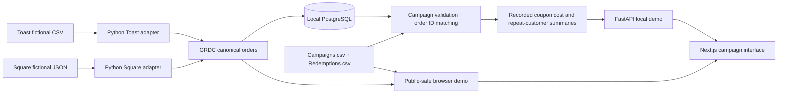

# GuestLift

**Campaign intelligence for restaurants, built on vendor-neutral POS data.**

[Campaign Lab](frontend/app/campaigns/page.tsx) · [Import Lab](frontend/app/import/page.tsx) · [Architecture](docs/architecture.md) · [Roadmap](ROADMAP.md) · [Implementation status](docs/IMPLEMENTATION_STATUS.md)

> **v0.4 — synthetic-data product prototype.** This repository is not connected to live Toast or Square accounts. It is not a production service and must never receive real customer data, payment-card data, or merchant credentials. Financial and loyalty figures are fictional and do not demonstrate incremental profit or causality.

## What someone can actually do

1. Open **Campaign Lab** (`/campaigns`) to see **56 fictional POS orders** (28 Toast-style + 28 Square-shaped) and **21 synthetic coupon redemptions** across two campaigns.
2. Download `Campaigns.csv` and `Redemptions.csv`, modify their sample entries, and upload both files in the browser. The report recalculates based on the uploaded data; invalid or unmatched records are explained.
3. Inspect recorded coupon discounts, net sales on redeemed orders, assumed campaign costs, and repeat purchasing **only when a fictional customer ID exists**.
4. Adjust the contribution margin assumption and export a campaign summary CSV.
5. Optionally sync the packaged synthetic sample into local PostgreSQL with **Save to local SQL** after starting Docker. Replaying an import does not double-count orders or redemptions.
6. Go to **Import Lab** (`/import`) to upload synthetic Toast-style CSVs or Square-shaped JSON and see provider-specific data transformed into GuestLift's common order model (GRDC).

## Local quickstart

Prerequisites: Docker Desktop (recommended). From the **repository root**:

```bash
docker compose up --build -d
docker compose ps
```

- Website: http://localhost:3000
- Campaign Lab: http://localhost:3000/campaigns
- Import Lab: http://localhost:3000/import
- Local FastAPI docs: http://localhost:8000/docs

Try **Campaign Lab → Download sample campaigns → upload both CSVs → inspect each campaign**. The browser demonstration works without the backend; with Docker running, you can select **Save to local SQL** for the bundled example.

### Tests

```bash
docker compose exec -T backend python -m pytest -q
docker compose exec -T frontend npm test
```

Expected in v0.4 source: **19 Python** and **19 JavaScript** tests. These cover the source adapters, financial calculations, coupon-to-order reconciliation, invalid imports, replay deduplication, and repeat-customer treatment.

**Important:** If you've already run a v0.3 Docker/PostgreSQL installation, the backend adds the optional `customer_id` column using a small additive schema migration. If you want a completely clean demo, the local-only `/api/reset` endpoint clears existing example records; don't use a volume-deleting command unless you intend to discard the demo database.

## Import formats

### POS data

- `Toast`: synthetic `OrderDetails.csv`, `ItemSelectionDetails.csv`, `PaymentDetails.csv`
- `Square`: synthetic `orders.json`, `payments.json`, `refunds.json`
- The fixture-only `GuestLift Test Customer Id` column in Toast is **not** a promised Toast export column. It is explicitly synthetic and optional. Square's fixture-only `customer_id` serves the same purpose.

### Campaign data

- [`Campaigns.csv`](frontend/public/samples/Campaigns.csv): campaign ID, coupon code/name, date window, and **assumed** campaign expenses.
- [`Redemptions.csv`](frontend/public/samples/Redemptions.csv): fictional redemption ID, campaign ID, provider, order ID, event time, and recorded coupon discount in integer cents.
- Download both CSVs together: [`campaigns-demo.zip`](frontend/public/samples/campaigns-demo.zip).

All CSV fields and validation behavior are documented in [docs/CAMPAIGN_IMPORT.md](docs/CAMPAIGN_IMPORT.md).

## Architecture



A static-hosted site analyzes *synthetic files in the browser*, with no public data-collection backend. A local Docker installation can persist those fictional records to PostgreSQL. Production merchant onboarding, OAuth integrations, tenant isolation, authentication, privacy controls, and real experimental design are **future work**.

## Financial interpretation

- **Sales on redeemed orders:** Actual net sales *within the fictional sample* for orders matched to recorded redemptions. **Not incremental revenue.**
- **Recorded discount:** Coupon discount in the synthetic redemption file, constrained to be no more than the discount already on the POS order.
- **Modeled contribution:** `(sales on redeemed orders × assumed contribution margin) − other per-redemption campaign cost − allocated fixed campaign cost`. POS discounts have **already reduced net sales** and are *not* subtracted again.
- **Repeat customer:** Provider-scoped fictional customer ID with at least two observed non-voided orders. Anonymous customers remain anonymous; no cross-provider identity linkage is assumed.

No uplift, retention causality, or restaurant ROI is claimed.

## Code map

| Directory | Role |
|---|---|
| `frontend/app/campaigns/` | Campaign Lab and interactive financial/customer reporting |
| `frontend/lib/campaign-model.mjs` | Public-safe pure JS CSV validation and calculation engine |
| `frontend/app/import/` | Browser synthetic POS import/validation lab |
| `backend/app/campaigns.py` | Local campaign CSV validation, matching, idempotent persistence |
| `backend/app/database.py` | SQL orders, campaign tables, redemptions, campaign import runs, metrics |
| `backend/app/main.py` | Local FastAPI demo endpoints |
| `backend/fixtures/` | Complete fictional POS and campaign examples |
| `frontend/tests/` / `backend/tests/` | JavaScript and Python regression tests |
| `docs/` | Architecture, campaign contract, design language, roadmap, deployment guidance |

## Deployment

See [docs/DEPLOYMENT.md](docs/DEPLOYMENT.md). The recommended first public site is a **static Next.js export** built from `frontend/`. **Never deploy the unauthenticated Docker backend or database publicly.** Public visitors should only use fabricated datasets.

GuestLift is an independent project, not affiliated with Toast, Square, or any restaurant chain. GRDC is a *proposed* internal contract—not an adopted industry specification.
