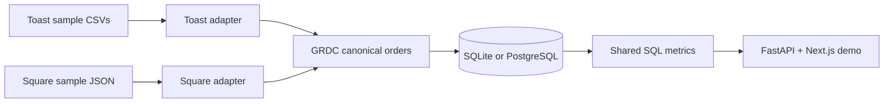

# GuestLift

**Different POS systems. One trusted restaurant data model.**

GuestLift is an independent restaurant data and promotion-intelligence prototype. It shows how fabricated **Toast POS-style CSVs** and **Square POS API-shaped JSON** become standardized orders through source-specific Python adapters, one **GuestLift Restaurant Data Contract (GRDC)**, and shared SQL analytics.

**[Start here](RUN_ME_FIRST.md)** · **[Publish on Cloudflare Pages](docs/DEPLOYMENT.md)** · **[Brand system](docs/BRAND_SYSTEM.md)** · **[Project roadmap](ROADMAP.md)** · **[System architecture](docs/architecture.md)** · **[Implementation status](docs/IMPLEMENTATION_STATUS.md)** · **[Demo script](docs/DEMO_SCRIPT.md)**

## See the site

GuestLift includes a responsive four-page website: a restaurant-operator landing page, an interactive architecture explanation, and a pipeline demo with source selection, record inspection, and dashboards.

| Page | Purpose |
|---|---|
| `/` | Explain the product and why consistent restaurant data matters |
| `/how-it-works` | Interactive explanation of the five pipeline stages |
| `/demo` | Switch Toast/Square sources, run sample imports, inspect canonical records and SQL-derived metrics |
| `/offers` | Define a fictional coupon/free-item offer and inspect modeled financial tradeoffs |

The pipeline demo has two modes: **browser preview** (no backend: bundled pre-normalized examples) and **API-connected** (Python adapters + SQL persistence). The UI labels the difference.

## Local quickstart — two terminals

**Prerequisites:** Node.js 20+ / npm and Python 3.11+.

**Terminal 1: Backend**

```bash
cd backend
python -m venv .venv
source .venv/bin/activate                # Windows: .venv\Scripts\activate
pip install -r requirements.txt
uvicorn app.main:app --reload --port 8000
```

The backend starts with a local SQLite database (`backend/guestlift_demo.db`). Visit http://localhost:8000/docs to inspect its endpoints. It has no merchant credentials or integrations.

**Terminal 2: Website**

```bash
cd frontend
npm install
npm run dev
```

Visit **http://localhost:3000**. Open **Interactive demo**, select Toast or Square, and click **Run sample pipeline**. The browser will connect to the backend if it is running; if not, the standalone browser preview still works using bundled pre-normalized examples.

**Optional: PostgreSQL using Docker Compose**

```bash
docker compose up --build
```

This serves the frontend on **localhost:3000**, FastAPI on **localhost:8000**, and PostgreSQL as an internal Docker service. The configured database password is **demo-only**, not for production use.

## Publish the public website

A public, static Next.js build can be deployed from this GitHub repo to **Cloudflare Pages** using `frontend/` as the root, `GUESTLIFT_STATIC_EXPORT=1 npm run build` as the command, and `out` as the output. See [step-by-step instructions](docs/DEPLOYMENT.md). The public website includes the operator-facing offer scenario, but does **not** expose the local unauthenticated Python API.

## Test the backend

```bash
cd backend
python -m pytest -q
```

Run the scenario math tests with `cd frontend && npm run test:offers`. The backend tests cover fixture parsing, missing/duplicate headers, financial calculations, repeated imports, SQL metrics, and API responses. A GitHub Actions workflow tests Python and attempts a frontend build when changes are pushed.

## How the pipeline works



**Initial metrics:** order count, pretax net sales, discounts and sales refunds. See [definitions](docs/METRICS.md). These are **not** causal marketing or loyalty ROI measurements.

## Repository structure

```text
frontend/             Next.js / TypeScript / CSS website
backend/app/          FastAPI, source adapters, GRDC models, SQL persistence
backend/fixtures/     Synthetic Toast CSVs and Square-shaped JSON
backend/tests/        pytest suite
docs/                 Architecture, metric definitions, demo script, status
.github/workflows/    CI checks
compose.yaml          Docker services (PostgreSQL + API + site)
ROADMAP.md             Product development checklist
```

## Current limitations

- **No actual coupon tracking or causal ROI estimate.** The offer studio is a scenario with configurable discount and margin assumptions, not measured redemptions or added traffic.
- **No production integrations.** Toast files are synthetic examples based on documented export fields. Square fixtures are *API-shaped*, not fetched from a Square Sandbox account yet.
- **No merchant data.** No credentials, card numbers, real customers, or real restaurant profit claims are present.
- **Not a production service.** The local API has no authentication, tenant permissions, rate limits or production security controls. Do not expose it publicly or upload sensitive data.
- **No real experiment engine.** Future work may add loyalty attribution and incremental contribution analysis, but the current prototype makes no causal claims.
- **No certified accounting model.** Current financial definitions are for the small demo; real POS financial treatment and order updates remain to be validated.

Read **[implementation status](docs/IMPLEMENTATION_STATUS.md)** for the distinction between finished code and pending roadmap items.

## Source documentation

- [Toast data export fields](https://doc.toasttab.com/doc/platformguide/adminDataExportFieldReference.html)
- [Toast data exports overview](https://doc.toasttab.com/doc/platformguide/adminDataExportOverview.html)
- [Square Orders API](https://developer.squareup.com/reference/square/objects/order)

GuestLift is an independent prototype and is not affiliated with or endorsed by Toast or Block/Square. GRDC is a proposed project contract, not an adopted external standard.
