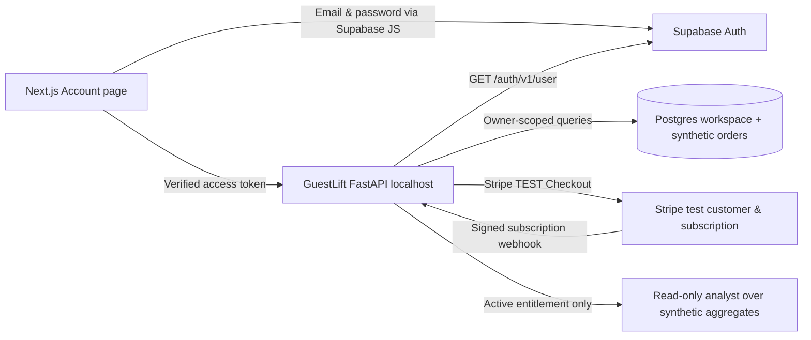

# GuestLift v0.5 — Account & Stripe Test Billing Setup

This guide is **optional**. The free synthetic sandbox works without credentials. Use real account/payment credentials **only for development and with Stripe TEST keys**. **DO NOT invite merchants or charge real money with v0.5.**

## Architecture



## 1. Configure Supabase Auth

1. Create your own Supabase project at <https://supabase.com/dashboard>. In the project settings, record **Project URL** and its **publishable** API key. Do **not** put a service role/secret key in the frontend.
2. Under **Authentication → Providers → Email**, enable email/password sign-up. Configure the email confirmation setting as appropriate for your test project and register your local allowed site / redirect URLs (e.g., `http://localhost:3000/account`).
3. From the **repository root**, create an ignored `.env` based on `.env.example`. Set the values below (replace with your own):

```dotenv
SUPABASE_URL=https://YOUR_PROJECT.supabase.co
SUPABASE_PUBLISHABLE_KEY=sb_publishable_...your key...
NEXT_PUBLIC_SUPABASE_URL=https://YOUR_PROJECT.supabase.co
NEXT_PUBLIC_SUPABASE_PUBLISHABLE_KEY=sb_publishable_...your key...
GUESTLIFT_APP_URL=http://localhost:3000
```

4. Rebuild: `docker compose up --build -d`. Open `http://localhost:3000/account` and use **Create account**. Confirm your email if prompted.
5. In `/workspace`, click **Use my account workspace**. The backend validates every bearer token against Supabase Auth and creates a **private synthetic workspace** keyed by the verified user ID. It never accepts a browser-supplied workspace ID to choose another owner's data.
6. Create a second test account. Confirm distinct workspace IDs through `/api/saas/me` with each authenticated token; verified routes are scoped to their owner. Real multi-user businesses and secure merchant uploads are **not** implemented.

**Note:** On a static public site with no deployed authenticated backend, account sign-in alone will not make the SaaS workspace function. Auth+private API require a separately secured backend deployment. Leave the public static build in sandbox mode until the production security milestone.

## 2. Configure Stripe TEST subscriptions

1. Sign into your Stripe dashboard and toggle **Test mode**. Create a recurring **Growth** subscription product, and copy its `price_...` ID. This *actual Stripe Price* determines the checkout amount; the website's **$149/location/month is merely a proposal** until you deliberately configure matching products and quantities. Current code requests a single unit of the configured Price; it does not automatically meter locations.
2. Set in ignored root `.env`:

```dotenv
STRIPE_SECRET_KEY=sk_test_...TEST secret key...
STRIPE_GROWTH_PRICE_ID=price_...TEST recurring price ID...
```

3. Install Stripe CLI on your Mac using Stripe's official instructions. Log in to your test account (`stripe login`). Start a local signed webhook listener in its own terminal:

```bash
stripe listen --forward-to http://localhost:8000/api/saas/billing/webhook
```

4. Copy the **test** signing secret printed by the CLI (`whsec_...`) to `STRIPE_WEBHOOK_SECRET` in `.env`. Recreate backend container: `docker compose up --build -d`.
5. Log into GuestLift, open **Account & billing**, and choose **Test Stripe subscription checkout**. The backend creates a Stripe-hosted **test-mode** Checkout session for the verified workspace.
6. Return to the workspace and refresh the page **after** the signed Stripe `customer.subscription.created` or `updated` webhook has been delivered. Only verified webhook status `active` or `trialing` enables the account analyst; clicking the success URL never upgrades the account directly.
7. Use the **test customer portal** to cancel/change the subscription and confirm that a subscription status event removes access when inactive. Audit all results in the Stripe test dashboard.

**Webhook events supported:** `checkout.session.completed`, `customer.subscription.created`, `customer.subscription.updated`, `customer.subscription.deleted`. Signature verification and event-ID deduplication are included. Full handling of overdue invoices, multiple subscriptions, webhook delivery ordering, reconciliation jobs, account recovery, disputes, dunning, and seat-based pricing remains **unfinished**.

### Endpoints (all account endpoints require verified bearer except Stripe signed webhook)

| Endpoint | Purpose |
|---|---|
| `GET /api/saas/me` | Create/read only the signed-in user's synthetic workspace, summary and plan |
| `POST /api/saas/profile` | Update limited non-sensitive business settings |
| `POST /api/saas/demo-reset` | Reset only the owner's synthetic sample dataset |
| `POST /api/saas/analyst` | Verified Growth entitlement, read-only metric answer |
| `POST /api/saas/billing/checkout` | Start Stripe TEST subscription Checkout |
| `POST /api/saas/billing/portal` | Open own TEST customer portal |
| `POST /api/saas/billing/webhook` | Verify Stripe signature and update test entitlement |

## 3. Optional model-backed analyst

The public/free analyst uses deterministic metrics and read-only approved questions. To use a genuine model, **only in local development** set:

```dotenv
GUESTLIFT_ENABLE_LLM=1
OPENAI_API_KEY=your_server_side_api_key
OPENAI_MODEL=your_supported_model_name
```

These are backend variables; **never** use `NEXT_PUBLIC_` for secrets. The server sends **only aggregate synthetic values** (e.g., sales totals and store summaries) to the model via the Responses API. It does not send customer IDs or row-level order records. If the API call fails, it falls back to a deterministic, evidence-labeled answer. A verified Growth subscription is still required for this private endpoint.

## 4. Production blockers

- Existing `/api/import`, `/api/upload` and `/api/reset` routes remain **unauthenticated localhost synthetic-demo routes**. They are not safe for public exposure. Separate/remodel the API before a live launch.
- No merchant onboarding, secure uploads, fully verified Stripe product quantities, team roles, invitations, audit trails, rate limits, quota enforcement, comprehensive migration strategy, or privacy/DPA review.
- Account data is fictional. Supabase email/password provides authentication, not a complete company-specific security/compliance posture.
- No public merchant-facing paid service has been deployed by this project.

References: [Supabase Auth for Next.js](https://supabase.com/docs/guides/auth/quickstarts/nextjs), [Stripe Checkout](https://docs.stripe.com/payments/checkout), [Stripe webhooks](https://docs.stripe.com/webhooks), [OpenAI Responses API](https://developers.openai.com/api/docs/guides/migrate-to-responses).
