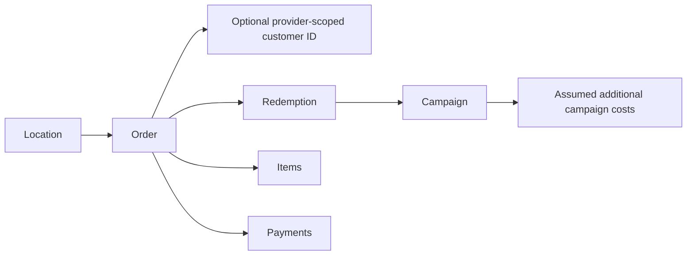

# GuestLift — Evidence-Backed Analyst (v0.5)

**Product idea:** A restaurant operator asks a question and gets a short answer, the verified metrics behind it, a limitation, and a next action. This is the start of an ontology-inspired restaurant intelligence model, **not** an autonomous Palantir-like deployment.

## Data relationships

**Never silently merge identities across POS providers.** A linked order/coupon does not prove a promotion caused the purchase.

## Allowed questions and tools

| Intent | Tool | Evidence |
|---|---|---|
| Total sales / AOV | `sales_overview` | non-voided orders, net sales, order count |
| Returning customers | `customer_repeat` | identified customers, repeat customers, coverage |
| Campaign discount exposure | `coupon_economics` | matched redemptions, recorded discount cents |
| Location comparison | `location_compare` | source-scoped locations and sales |

Proactive pattern rules flag **low customer coverage**, **large discount exposure**, and **large observed location differences** only when sample data satisfies basic minimums. A warning is an **investigation suggestion**, not a model forecast or statistical anomaly claim.

**Server trust boundary:** The optional LLM sees vetted **aggregated synthetic metrics only**. It does not get credentials, arbitrary database access, customer IDs, order IDs or the ability to send promotional messages. The public sandbox uses only deterministic rules. User questions cannot execute arbitrary generated SQL or send coupons.

## Next validation milestones

- Real operator question collection and an accuracy/refusal evaluation suite.
- Approved read-only SQL tools with explicit query allowlists and tenant isolation.
- Confidence and data coverage gating before proactive insights.
- Account quotas and token cost controls before billable live model use.
- Privacy/retention controls for real merchant data, plus explainable cohort/window definitions.
- Product experiments to confirm restaurant managers actually find the recommendations useful.
