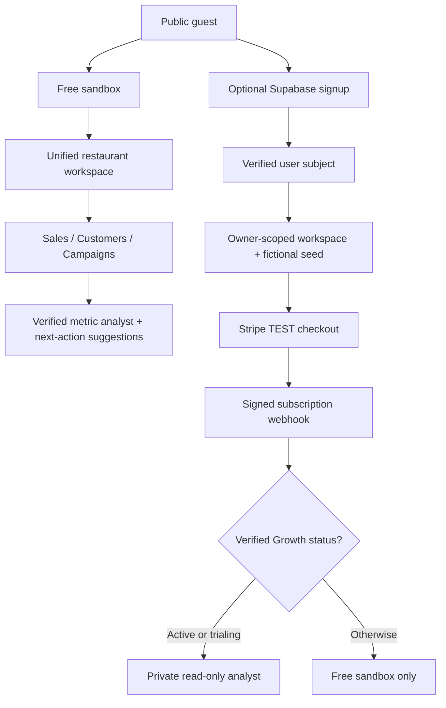

# GuestLift — SaaS Foundation Architecture (v0.5)

> **State:** Synthetic-data prototype and *test-mode* account/billing foundation. Not production certified.

## Customer journey

## Operator ontology — first iteration

Relationships are explicit: `workspace → location → order → optional customer alias` and `order → campaign redemption → campaign`. Provider-specific customer IDs are scoped to their source; GuestLift does not merge identities without evidence or authorization. Campaign discounts are already reflected in recorded net sales and never subtracted twice.

## Security boundary and data lifecycle

- **Public browser:** fictitious sample records only, no real account needed, browser-only question tools.
- **Private REST endpoints:** `Authorization: Bearer` access token is verified with Supabase Auth before accessing a workspace, profile, entitlement or paid analyst. Each workspace's sample orders are queried by a **server-owned workspace key**; a client cannot choose another workspace ID.
- **Stripe:** test secret required, checkout server-created, entitlements updated only from verified subscription status webhook events. No raw card data touches GuestLift.
- **Optional OpenAI:** only computed, non-identifying synthetic aggregate results, sent server-side. No customer/order records or credentials. The model may explain evidence, but SQL and financial computations are performed outside the model.
- **Storage:** SQLAlchemy creates additional additive `saas_...` tables in local Postgres; full Alembic migrations, secure hosting and production multi-user permissions are missing.

## Production blockers

The historic v0.1–v0.4 demo endpoints are unauthenticated and remain localhost only. Do not expose the combined API. Implement separately secured routes or split a new service, key management, formal migrations, tenant policies, audit logs, quotas/rate limits, monitoring, retention/deletion, encryption, RLS/authorization testing, security review, and vendor permissions before accepting real data or live Stripe charges.
