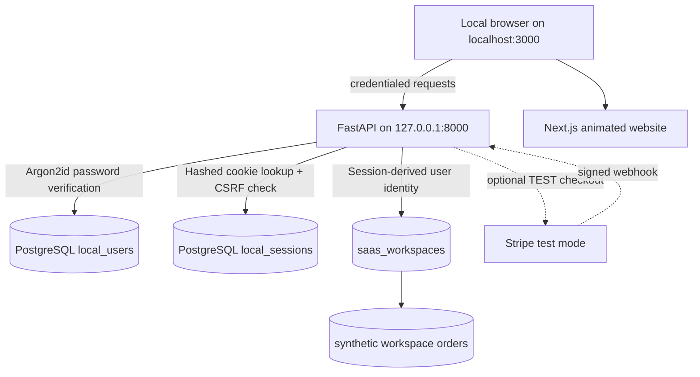

# TableSignal v0.8 — Local account and SaaS storage architecture

- New `local_users` and `local_sessions` tables coexist with existing synthetic `saas_workspaces` and `saas_workspace_demo_orders` in the same persistent Docker database volume.
- The browser receives an unpredictable 48-byte session secret in an HttpOnly, SameSite-Strict cookie. The database stores only a SHA-256 digest. API reads derive ownership from the session and never accept a caller-supplied workspace owner ID.
- Browser scripts receive a harmless `cookie-session` **presence indicator** for compatibility with existing UI code; it is not a bearer token and cannot grant access. The backend ignores it. The real session secret cannot be read by JavaScript.
- Browser POST requests to authenticated endpoints require an `X-CSRF-Token` obtained from the authenticated `/api/local-auth/session` response; the backend checks it against the database and validates local Origin.
- Password changes require the current password and revoke other sessions. Manual developer recovery is available only from an interactive Docker console.
- Optional Stripe test subscription events must be signed and verified; the user is never considered paid solely because a browser visited a success URL.

**Production blockers:** No email ownership verification or automated email recovery, no multi-device session-management UI, in-memory rather than distributed login rate limiting, TLS-only cookie mode not configured, no SSO/2FA, no organization membership roles, incomplete hosted tenant audits, public demo endpoints, no formal migrations/backup service, no merchant data authorization, no live payment validation. This architecture is for developer-only localhost use.
