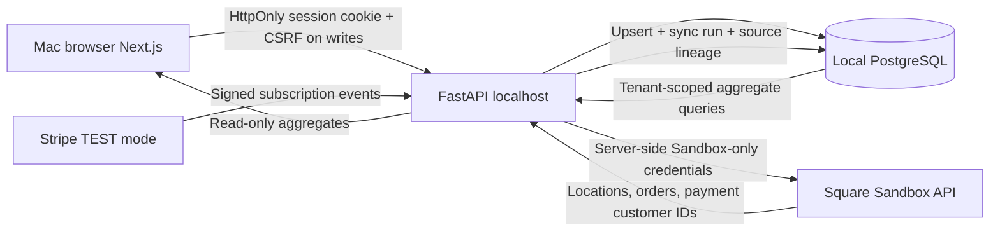

# TableSignal v0.9 architecture — account-scoped source ingestion

## Model

- `local_users` / `local_sessions`: local development authentication. Argon2id hashes, opaque revocable cookies, CSRF/origin checks.
- `saas_workspaces`: one workspace owned by one local user, restaurant profile, Stripe test subscription IDs and status.
- `square_sandbox_connections`: one Sandbox merchant per workspace, seller ID, connection mode and encrypted OAuth credentials (if OAuth). Environment developer token stays in server `.env`, not SQL.
- `square_sandbox_oauth_states`: hashed, single-use 10-minute OAuth anti-forgery state linked to the initiating workspace. Callback does not depend on session cookies, which are `SameSite=Strict`.
- `square_sandbox_orders`: source order ID unique within workspace, status, location, optional customer ID, observed amount, tax/tip, discount, created/updated timestamps.
- `square_sandbox_sync_runs`: attempted/successful/failed imports, counts and timestamps; no raw Square tokens, card numbers or customer PII in logs.
- `assisted_setup_requests`: local intake, no external support notification.

## Tenant isolation

All reads derive workspace ID from authenticated server session, not from a browser-provided workspace key. Data access includes `workspace_id` in SQL filters. A merchant ID can only be assigned to one workspace at a time. No public API provides merchant tokens. A private workspace starts empty even if the legacy fictional sample table has data from v0.8.

## Financial methodology

The demo order metric is `Square order.total_money.amount - total_tax_money.amount - total_tip_money.amount` for non-canceled completed USD orders in the bounded 180-day window. Square's order rollups, refunds, settlement reports, service charges, discounts and payment reconciliation need much more rigorous modeling before this can be labeled production **net sales** or **profit**. Coupons in Square orders are not automatically verifiable marketing attributions. Paid analyst is read-only and refuses to analyze a non-connected account.

## API

| Route | Auth | Purpose |
|---|---|---|
| `GET /api/saas/me` | Auth cookie | Workspace + SQL-backed aggregate summary |
| `POST /api/saas/profile` | Auth + CSRF | Save profile |
| `POST /api/saas/analyst` | Auth + CSRF + active Stripe **test** subscription + source | Read-only analyst |
| `GET /api/integrations/square/status` | Auth | Connection status, recent runs, assisted requests |
| `POST /api/integrations/square/connect-developer-sandbox` | Auth + CSRF | Bind own local Sandbox seller using env credential |
| `POST /api/integrations/square/oauth/start` | Auth + CSRF | Generate short-lived Sandbox authorization URL |
| `GET /api/integrations/square/oauth/callback` | Valid single-use state | Exchange code, encrypt and store tokens |
| `POST /api/integrations/square/sync` | Auth + CSRF | Fetch, validate, upsert, audit Sandbox orders |
| `POST /api/integrations/square/disconnect` | Auth + CSRF | Delete local connection and imported Sandbox orders |
| `POST /api/integrations/square/assisted-setup` | Auth + CSRF | Store local setup request |

All endpoints are **local-only development APIs**. Existing unauthenticated `/api/import`, `/api/reset`, `/api/upload` demo endpoints are intentionally retained for the synthetic public mock demonstration and are NOT safe for public exposure.

## Migration/scale considerations

The local release uses additive SQLAlchemy `create_all` for new tables, preserving existing Docker volume. Before public deployment: adopt Alembic or equivalent tracked migrations, RLS/tenant audit, secure managed Postgres, HTTPS/secure cookie config, server-side queue and retries, webhook verification/reconciliation, expiration/rotation of OAuth keys, per-tenant data deletion/retention, secrets manager, backups, customer consent and vendor certification. Self-service multi-user roles and team invitations are not implemented.
