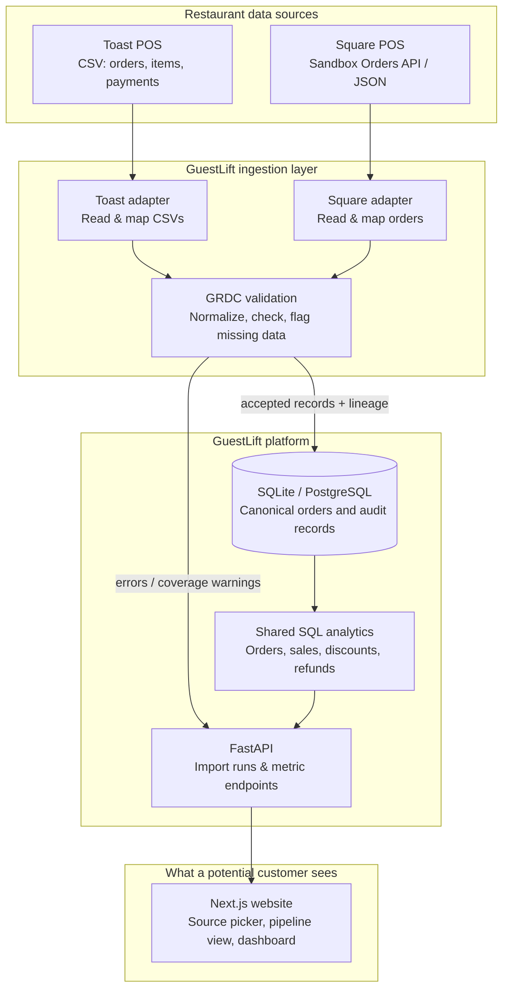
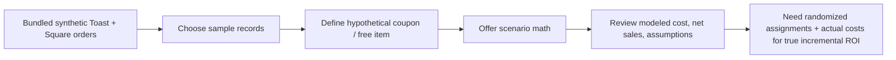

# GuestLift — Architecture & Demo Storyboard

> **Version:** 0.2 (demo-first)  
> **Current state:** Prototype backend and frontend code included; Toast/Square sample adapters and local SQL metrics run with fictional records. No real merchant integrations or hosted service. SQLite is the default local database; PostgreSQL is configured through Docker Compose but has not been verified in this build environment.  
> **Sources:** Toast POS and Square POS; **Square POS is not Squarespace Commerce**.

## The product in one sentence

GuestLift turns data from different restaurant POS providers into **one verified format**, allowing restaurant groups to compare sales, customer activity, and eventually loyalty promotions without rebuilding their analytics for each provider.

## Architecture

**Principle:** Source adapters may differ, but **all downstream analytics use the same GuestLift Restaurant Data Contract (GRDC)**. No vendor-specific metric calculations in the dashboard.

## Added v0.2 marketing workflow (public browser-only demo)

The live **public** application will show an additional decision-making route without needing a publicly hosted data API:

The coupon name is a scenario label, not a link to verified coupon redemptions. The engine assumes every qualifying sample order redeems once, and holds actual purchase volume unchanged. It is not a promotion attribution or lift-analysis tool yet. The **local** Python API and SQL pipeline remain available via Docker for source engineering demonstrations, but are not exposed by the recommended public static deployment. See `docs/PRODUCT_SCOPE.md`.

## Five-minute demo storyboard

| Step | What the visitor sees | What it proves |
|---|---|---|
| **1. Choose a provider** | Two sample buttons: *Toast Demo* and *Square Demo* | The product is designed for more than one vendor |
| **2. Inspect the source** | A small sample order in Toast-style CSV or Square-shaped fixture JSON | The raw formats are different |
| **3. Run the pipeline** | A stage diagram: source → adapter → validation → GRDC → database | GuestLift standardizes data rather than maintaining separate dashboards |
| **4. Compare before/after** | The source order beside a canonical GRDC order | Shared concepts are preserved and unknown fields are surfaced |
| **5. View analytics** | Order count, net sales, and discounts/refunds where available | The same reporting rules can work across both providers |
| **6. Inspect quality** | Accepted/rejected counts and click-through source lineage | The system can explain and audit its numbers |

At **M1**, this flow is a labeled **interactive mock**. From **M2–M5**, stage results are progressively replaced with working imports, database queries, and API outputs. Never label mocked results as live.

## Initial data contract (small on purpose)

| Entity | Minimal business meaning |
|---|---|
| `location` | Which restaurant location a record belongs to |
| `order` | One provider order, with its source ID, status, timestamps, and currency |
| `order_item` | An item line and quantity associated with an order |
| `payment` | A payment event or status associated with an order, without raw card details |
| `import_run` | How and when data was loaded; source, counts, and errors |

A full customer identity system, loyalty rewards, inventory, cost of goods, and campaign assignments are **not required** for the first working demo. Adding them requires explicit source support or separate authorized inputs.

## Initial implementation choices

- **Toast:** Use fabricated small CSVs based on [Toast's published export fields](https://doc.toasttab.com/doc/platformguide/adminDataExportFieldReference.html). Live exports require a merchant's permissions and configuration.
- **Square:** Use [Square-shaped fixture](https://developer.squareup.com/docs/devtools/sandbox/overview) and [Orders API](https://developer.squareup.com/reference/square/orders) to create/query synthetic orders. Production OAuth and real merchant connections are not part of v1.
- **Normalization:** Python adapters produce a canonical GRDC record validated with Pydantic/JSON Schema.
- **Storage:** PostgreSQL, with provider/source IDs so imports are traceable and duplicates can be prevented.
- **Backend:** FastAPI serves import runs, canonical records, and shared metrics.
- **Frontend:** Next.js/TypeScript + Tailwind CSS shows the pipeline and business insights.
- **Local operation:** Docker Compose; no mandatory cloud bill.

## Example of what standardization means

The following is a **conceptual illustration**, not a verified vendor schema or real transaction:

| Concept | Toast-style source | Square-style source | GuestLift GRDC |
|---|---|---|---|
| Order identifier | `Order Id` | `order.id` | `source_order_id` |
| Location | `Location` | `order.location_id` | `source_location_id` |
| Total amount | Decimal currency amount in a report | `order.total_money.amount` in minor units | `total_amount_minor` + `currency` |
| Item records | Item Selection CSV | `order.line_items[]` | `order_items[]` |

A parser must use the actual selected fields and determine whether amounts include tax, tips, or refunds. Values with different definitions **must not be treated as interchangeable** simply because column names sound alike.

## Demo definition of done

- [ ] The architecture diagram renders on GitHub and is linked from README.
- [ ] A new viewer can understand the product's benefit in under two minutes.
- [ ] Both source buttons lead to clearly labeled sample data.
- [ ] The UI explicitly distinguishes an interactive mock from implemented processing.
- [ ] In the final connected demo, order counts and financial totals match independently checked fixtures and each figure has visible lineage.

## What this does *not* claim

This first demo does not prove that a restaurant promotion increases incremental profit or that we already integrate with live Toast/Square accounts. Those require additional data, permissions, measurement design, and product development.

## Implemented endpoints in v0.1

- `GET /api/health`: demo connection check.
- `GET /api/preview/{toast|square}`: show test source records and the normalized output.
- `POST /api/import/{toast|square}`: run the actual local Python adapter and persist canonical orders; repeated imports report duplicates.
- `GET /api/metrics`: order, discount, net sale, refund and location summaries from the SQL database.
- `GET /api/imports`: import history.
- `POST /api/reset`: clear the disposable local demonstration database.

**Security note:** These are unauthenticated local demo endpoints; do not deploy them publicly without access control and other safeguards.
